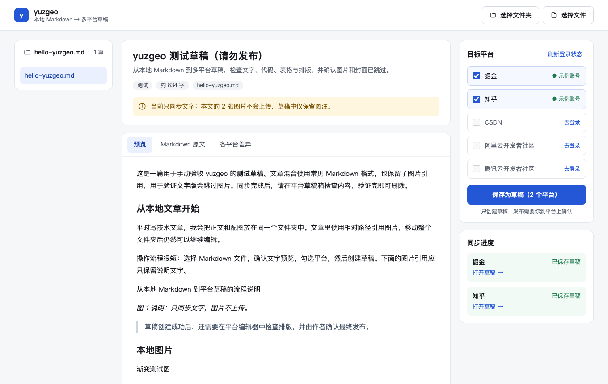

<div align="center">

# yuzgeo

**开源的多平台文章同步 Chrome 扩展：把本地 Markdown 一键保存为掘金、知乎、CSDN、阿里云开发者社区、腾讯云开发者社区、抖音长文、小红书长文的草稿。**

简体中文 · [English](README.en.md)

[](https://github.com/yuzhh-official/yuzgeo-chrome-extension/actions/workflows/ci.yml)
[](LICENSE)


</div>



## yuzgeo 是什么？

yuzgeo 是一个**免费、开源（MIT）、纯本地运行**的 Chrome 浏览器扩展，用来做**技术博客的多平台分发**：你在本地用 Markdown 写好文章，选择文件或文件夹，勾选目标平台，yuzgeo 会使用你在浏览器中已有的登录状态，在每个平台上**创建一篇草稿**。最终是否发布、何时发布，由你在平台编辑器里确认。

它适合在多个中文技术社区同时写作的开发者、技术博主和团队：一次写作，多平台成稿，省去在各编辑器之间反复复制粘贴、调整格式的时间。

## 功能

- **本地 Markdown 输入**：选择单个 `.md` 文件，或选择整个文件夹浏览其中所有文章；本地原文件不会被修改。
- **front-matter 支持**：读取 `title`、`summary`/`description`、`tags`；没有 `title` 时使用正文的一级标题。
- **一键多平台草稿**：同时保存到多个平台，每个平台独立显示进度、草稿链接和失败原因，失败可单独重试。
- **按平台转换格式**：掘金、CSDN、阿里云、腾讯云、抖音长文保存 Markdown 原文；知乎转换为富文本，代码块使用知乎编辑器格式；小红书长文由扩展在后台打开编辑器、填入内容并点击它自己的“存草稿”，草稿保存在当前浏览器的小红书草稿箱里。
- **发布前预览**：预览、Markdown 原文、各平台差异三个视图，提前知道每个平台会收到什么。
- **同步历史**：本地记录最近的同步任务和草稿链接。
- **隐私优先**：没有服务端、没有埋点、不收集 Cookie；只申请目标平台域名的权限；需要时仅在目标创作平台执行页面函数，不安装常驻内容脚本。

## 支持的平台

| 平台             | 保存格式                       | 登录检测 | 草稿                    | 状态                                         |
| ---------------- | ------------------------------ | -------- | ----------------------- | -------------------------------------------- |
| 掘金             | Markdown                       | ✅       | ✅                      | 已接入，待真实账号验证                       |
| 知乎专栏         | 富文本（HTML）                 | ✅       | ✅                      | 已接入，待真实账号验证                       |
| CSDN             | Markdown                       | ✅       | ✅                      | 已接入，待真实账号验证                       |
| 阿里云开发者社区 | Markdown                       | ✅       | ✅                      | 已接入，待真实账号验证                       |
| 腾讯云开发者社区 | Markdown                       | ✅       | ✅                      | 已接入，待真实账号验证                       |
| 抖音长文         | Markdown                       | ✅       | ✅                      | 已接入，待真实账号验证                       |
| 小红书长文       | 由编辑器排版                   | ✅       | ✅ 存入浏览器本地草稿箱 | 已接入，待真实账号验证                       |
| 搜狐号           | 编辑器排版；代码、表格转为段落 | ✅       | 已实现                  | 登录已实测；当前账号未实名，存草稿被平台禁用 |
| 百家号           | 富文本（HTML）                 | 已实现   | 已实现                  | 待真实账号验证                               |

> **当前版本只同步文字。** 标题、段落、代码块、表格、链接和图片说明会保留；正文图片和封面不会上传。图片转存在后续版本提供。

搜狐号使用新的编辑器标签页，仅点击“存草稿”，账号限制会明确提示；百家号使用草稿接口，编辑器令牌仅在请求期间使用。证据和限制见[接入记录](docs/PLATFORM-NOTES-sohu-baijiahao.md)。

## 工作原理

1. 在扩展页面选择本地 Markdown 文件或文件夹，扩展在浏览器内解析 front-matter 和正文。
2. 你勾选已登录的平台，扩展按各平台要求转换格式（Markdown 或富文本）。
3. 扩展在后台使用你浏览器中的登录状态，调用平台创作后台的草稿接口，为每个平台创建一篇草稿。
4. 完成后显示每个平台的草稿链接，你到平台编辑器中检查并决定是否发布。

所有处理都在你的浏览器内完成，文章内容只会发送到你勾选的平台。

## 安装

yuzgeo 尚未上架 Chrome 应用商店，目前需要从源码构建（需要 Node.js ≥ 22 和 pnpm）：

```bash
git clone https://github.com/yuzhh-official/yuzgeo-chrome-extension.git
cd yuzgeo-chrome-extension
pnpm install
pnpm build
```

然后在 Chrome 打开 `chrome://extensions`，开启“开发者模式”，点击“加载已解压的扩展程序”，选择 `packages/extension/.output/chrome-mv3` 文件夹。点击工具栏中的 yuzgeo 图标即可打开工作台。

## 写作约定

```markdown
---
title: 文章标题
summary: 一句话摘要，会作为平台摘要
tags: [前端, Chrome 扩展]
---

正文从这里开始……
```

## 常见问题

**yuzgeo 和手动复制粘贴有什么区别？**
yuzgeo 会按平台自动转换格式并一次创建多个草稿，代码块、表格等排版不用在每个编辑器里重新调整。

**会自动发布文章吗？**
不会。yuzgeo 只创建草稿，发布始终需要你本人在平台上确认。

**我的账号密码和 Cookie 会被上传吗？**
不会。yuzgeo 不需要输入账号密码，没有服务端，也不上传任何 Cookie；它只是在你的浏览器里，以你当前的登录身份请求目标平台。

**支持图片吗？**
当前版本只同步文字，图片会被跳过并保留图片说明。图片上传正在规划中。

**为什么要求这些浏览器权限？**
`storage` 用于保存设置和同步历史，`cookies` 用于读取个别平台的登录标识和要求回传的 CSRF 令牌，`declarativeNetRequest` 用于给扩展自己发出的请求设置平台要求的来源头。权限只覆盖已接入平台的域名。

**有风险吗？**
yuzgeo 调用的是各平台创作后台的接口，这些接口并非公开 API，平台随时可能调整，也可能与部分平台的用户协议不一致，存在账号风控风险，请自行评估后使用。

**能让 AI Agent 调用吗？**
仓库中已包含 MCP Server 的骨架（`@yuzgeo/mcp-server`），后续将支持 Claude 等 AI Agent 通过 MCP 把本地文章保存为多平台草稿。

## 路线图

- [x] 本地 Markdown 解析、预览与多平台文字草稿
- [x] 掘金、知乎、CSDN、阿里云开发者社区、腾讯云开发者社区
- [ ] 真实账号端到端验证
- [ ] 图片与封面上传
- [ ] MCP Server：让 AI Agent 创建草稿
- [x] 抖音长文
- [x] 小红书长文
- [x] 搜狐号、百家号适配器（真实草稿验证待完成）
- [ ] 微博头条文章（暂缓）
- [ ] 上架 Chrome 应用商店

## 开发

```bash
pnpm install
pnpm dev          # 开发模式（自动打开 Chrome 加载扩展）
pnpm build        # 构建所有包，扩展产物在 packages/extension/.output/chrome-mv3
pnpm test
pnpm lint
pnpm typecheck
```

浏览器回归测试（使用独立的临时浏览器配置，不会用到个人账号，也不会创建真实草稿）：

```bash
pnpm --filter @yuzgeo/extension exec playwright install chromium
pnpm --filter @yuzgeo/extension test:ui
pnpm --filter @yuzgeo/extension test:background
```

Windows 也可以使用已安装的 Edge：先在 PowerShell 中设置 `$env:YUZGEO_TEST_BROWSER = 'msedge'`，再运行 `test:ui`。

| 包                    | 说明                                                       |
| --------------------- | ---------------------------------------------------------- |
| `packages/core`       | 平台无关的类型、协议与 Markdown 处理                       |
| `packages/extension`  | 基于 WXT + React 的 Chrome 扩展                            |
| `packages/mcp-server` | `@yuzgeo/mcp-server`，stdio MCP Server + 本地 WebSocket 桥 |

技术方案见 [docs/DESIGN.md](docs/DESIGN.md)。欢迎提交 Issue 和 Pull Request，尤其是新平台适配和接口变更的修复。

## 许可证

[MIT](LICENSE)

<sub>关键词：多平台文章同步、一文多发、博客同步工具、Markdown 发布、掘金 知乎 CSDN 同步、技术博客分发、Chrome 扩展、开源</sub>
