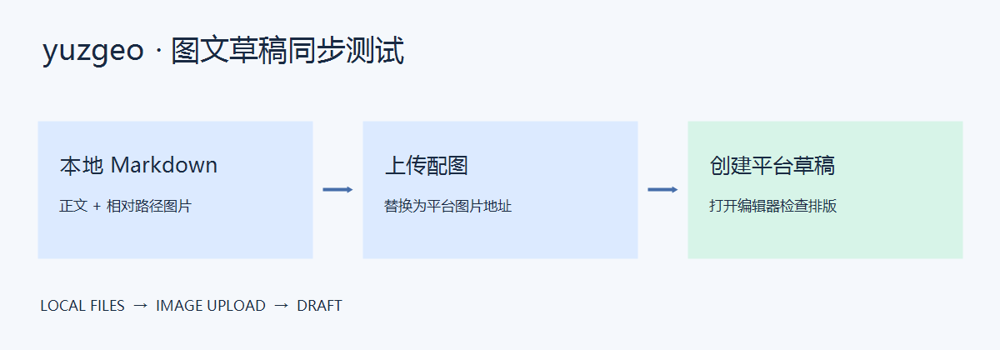

这是一篇用于手动验收 yuzgeo 的**测试草稿**。文章混合使用常见 Markdown 格式，也保留了图片引用，用于验证文字版会跳过图片。同步完成后，请在平台草稿箱检查内容，验证完即可删除。

## 从本地文章开始

平时写技术文章，我会把正文和配图放在同一个文件夹中。文章里使用相对路径引用图片，移动整个文件夹后仍然可以继续编辑。

操作流程很短：选择 Markdown 文件，确认文字预览，勾选平台，然后创建草稿。下面的图片引用应只保留说明文字。



_图 1 说明：只同步文字，图片不上传。_

> 草稿创建成功后，还需要在平台编辑器中检查排版，并由作者确认最终发布。

## 本地图片


_图 2 说明：彩色渐变测试图，同时在元数据中指定为封面；两者都应跳过。_

预览和平台草稿中不应出现图片或失效图片占位。图片说明及前后的段落仍应完整。

### 重复引用同一张图

下面再次引用图 2，确认重复图片引用也只保留说明文字。


## 代码块

```ts
function greet(name: string): string {
  return `Hello, ${name}`;
}

console.log(greet('yuzgeo 文字测试'));
```

行内代码也应该保持清晰，例如 `pnpm dev`、`title` 和 `./images/gradient.png`。这里还包含 **加粗文本**、_斜体文本_、~~删除线~~，以及特殊字符：`<article>`、`a & b`。

## 列表与链接

导入文章前：

1. 在浏览器中登录需要测试的平台。
2. 在扩展中选择本文，或选择 `test-post` 文件夹后打开本文。
3. 确认预览中文字、代码和表格显示正常，图片已跳过。
4. 创建草稿，并打开返回的草稿链接。

检查正文时关注这些细节：

- 正文是否保留原有标题层级。
- 图片前后的段落是否完整。
- 重复图片引用是否只保留说明。

链接示例：[Markdown 基础语法](https://www.markdownguide.org/basic-syntax/)。

## 公式兼容性观察

这一节用于观察平台对公式的实际处理方式，记录它是正常渲染、保留源码还是丢失内容。

行内公式 $E = mc^2$，块级公式：

$$
\sum_{i=1}^{n} i = \frac{n(n+1)}{2}
$$

## 表格

| 检查项   | 预期结果                   | 检查位置   |
| -------- | -------------------------- | ---------- |
| 文章标题 | 显示 front-matter 中的标题 | 草稿标题栏 |
| 本地图片 | 三处图片均跳过，仅保留说明 | 正文       |
| 代码块   | 换行、缩进和中文字符串完整 | 代码段落   |
| 表格     | 表头与三列内容完整         | 本节       |
| 重复图片 | 两处渐变图均跳过           | 正文       |

---

## 验收记录

- [ ] 标题正确，正文没有出现 YAML 元数据。
- [ ] 三处图片引用均跳过，说明文字保留。
- [ ] 封面已忽略，无图片上传步骤。
- [ ] 标题层级、引用、列表、链接和表格可读。
- [ ] 代码没有丢失换行或缩进。
- [ ] 已记录公式在该平台上的显示效果。
- [ ] 已检查草稿，尚未发布文章。

测试结束。可以删除这篇草稿，或保留用于下一次版本回归。
